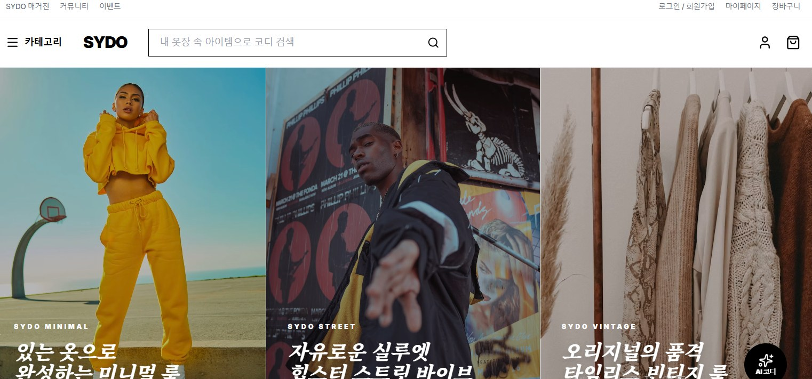

# SYDO | Show Your Daily Outfit

사용자가 일상 코디를 탐색하고 추천받을 수 있도록 만든 패션 스타일링 웹 서비스의 **프론트엔드**입니다.
평택대학교 캡스톤 디자인 팀 프로젝트로 진행했으며, 이 저장소는 제가 담당한 프론트엔드 코드를 공개용으로 올려 둔 것입니다.
(팀 전체 저장소는 비공개입니다.)



## 결과

- 교내 캡스톤 프로젝트 **우수과제 제출자 선정, 장학금 수혜**

## 담당 역할

- React 기반 프론트엔드 담당
- 피드 및 코디 투표 UI 구현
- 페이지 전환 및 컴포넌트 구조 구성
- 프로토타입을 먼저 제작해 팀에 공유하고, 피드백을 받아 화면과 기능을 구체화

## 협업 과정

프로젝트 초기에는 역할 분담과 협업 방식이 정리되지 않아 첫 발표에서 완성도가 부족하다는 평가를 받았습니다.
프론트엔드 프로토타입을 먼저 만들어 보여주고 피드백을 요청한 뒤, 필요한 기능을 함께 정리하고 각자 맡을 부분을 구체적으로 나눠
진행 상황을 공유하는 방식으로 협업을 다시 정비했습니다.

## 주요 화면

| 화면 | 컴포넌트 | 내용 |
|---|---|---|
| 홈 | `MainBanner`, `RecommendationSection` | 스타일별 메인 배너, 추천 코디 |
| 카테고리 메뉴 | `CategoryModal` | 오늘의 코디 추천, 디지털 옷장, A/B 코디 투표, 스타일 쉐어링, AI 스타일 분석 |
| 커뮤니티 | `CommunityView` | A/B 코디 투표, 스타일 쉐어링 |
| AI 스타일링 | `FloatingAIButton`, `AIStylingModal` | 옷 사진을 올리면 스타일 정의·추천 조합·스타일링 팁 제공 (Gemini API) |
| 쇼핑 | `SearchView`, `ProductDetailView`, `CartView` | 검색, 상품 상세, 장바구니 (`CartContext`로 상태 공유) |
| 기타 | `MagazineView`, `EventView`, `LoginView`, `MyPageView` | 매거진, 이벤트, 로그인, 마이페이지 |

## 기술 스택

React 19 · TypeScript · Vite · Tailwind CSS · Motion · Google Gemini API · Netlify

## 실행 방법

```bash
cd SYDO
npm install
# AI 스타일링 기능을 쓰려면 SYDO/.env 파일에 키를 넣습니다 (저장소에는 포함하지 않음)
# GEMINI_API_KEY=발급받은_키
npm run dev        # http://localhost:3000
```

## 폴더 구조

```
SYDO/
├─ src/
│  ├─ App.tsx              화면 전환(View 상태)과 전체 레이아웃
│  ├─ components/          화면·UI 컴포넌트
│  ├─ lib/CartContext.tsx  장바구니 상태 공유
│  └─ services/geminiService.ts  AI 스타일 분석 요청
├─ netlify.toml            Netlify 배포 설정
└─ vite.config.ts
```
